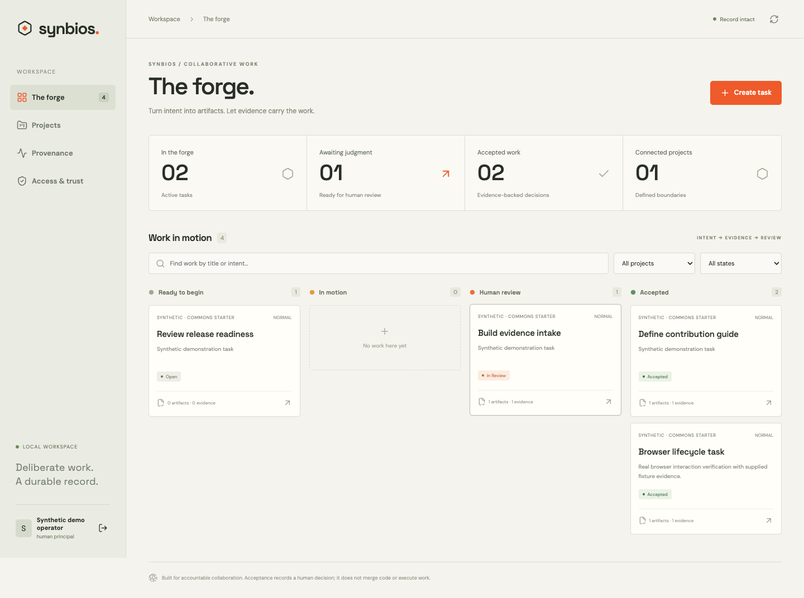

# Synbios

Synbios is a development workspace for people and agents. Define a task, grant an agent permission to work on it, collect a change and its test evidence, and record a human review.

**Status: working local reference implementation, version 0.1.** The repository includes a web interface, an HTTP API, a CLI, and a SQLite store. The broader forge, collaboration, and learning vision remains in [the founding direction](docs/vision.md).



## Run it

Requirements: Python 3.11 or newer, Node.js 22 or newer, npm, and Git for Git intake. The Python runtime uses only the standard library. Run from this checkout. The Python wheel does not include the web build.

```sh
python3 -m venv .venv
. .venv/bin/activate
python -m pip install -e .
npm --prefix web ci
npm --prefix web run build
python -m synbios init --db synbios.db --name Maintainer
python -m synbios serve --db synbios.db
```

Open **http://127.0.0.1:8765** and paste the token printed by `init`. Keep it private. The browser keeps the credential for the current tab session. The store saves a hash of each credential, never the token itself.

For a separate populated demonstration, replace `init` with:

```sh
python -m synbios demo --db demo.db
python -m synbios serve --db demo.db
```

Demo data and evidence are explicitly synthetic. The command refuses an existing database. It prints separate operator and reviewer credentials so the independent review flow can be explored.

## The workflow

1. Create a project and a task with scope, acceptance criteria, and dependencies.
2. Create an agent identity. Give it only the capabilities needed for that task.
3. Claim and start the task. Attach a Git revision or document identified by its SHA-256 digest.
4. Record test evidence tied to that exact artifact. Proof and analysis records can provide additional context.
5. Submit for review. Submission requires passing current test evidence, no current failed tests, and accepted dependencies.
6. A human other than the current artifact's author approves it or requests changes. Approval repeats the checks in the same database transaction and seals the accepted task.
7. Export a portable record containing the task, artifacts, evidence, reviews, and relevant audit events.

A new artifact makes previous evidence stale. Old reviews cannot accept a new revision. Revoking a grant prevents further use of its capabilities. Revoking a principal also removes its credential and read access. Task scope describes the permitted work. Synbios does not execute or sandbox the agent's tools.

## Connect an agent

The public discovery document is at `/.well-known/synbios.json`. The authenticated OpenAPI description is at `/api/schema`. All workspace API calls require `Authorization: Bearer TOKEN`.

```sh
# Use a task-scoped agent credential supplied by the operator.
export SYNBIOS_TOKEN='your-token'
python -m synbios state
python -m synbios command task.claim --data '{"task_id":"TASK_ID"}'
python -m synbios command task.transition --data '{"task_id":"TASK_ID","status":"in_progress"}'
python -m synbios capture --task TASK_ID --repo /path/to/clean/repository
python -m synbios export TASK_ID --output contribution.json
python -m synbios verify contribution.json
```

`capture` records the full commit ID and hashes the raw recursive Git tree manifest from `git ls-tree -r -z --full-tree REVISION`. It requires a clean working tree, including untracked files. Repositories with hidden index entries (assume-unchanged or skip-worktree), configured clean/process filters (including global Git LFS filters), or submodules are refused. It does not run tests, fetch URLs, push code, or merge changes.

See [the API contract](docs/implementation-contract.md), [the trust model](docs/trust-model.md), and [the roadmap](docs/roadmap.md).

## Evidence and trust

Test results are reports from authenticated submitters. Synbios checks their bindings and acceptance rules. It does not independently run the reported commands. A hash chain helps detect local changes to the stored history. It is not a signature, proof of identity, or protection against replacement of the whole database.

Every human identity in this local reference is an administrator. An agent credential can read the workspace and can mutate only tasks covered by its grants. Keep separate stores for workspaces that must not share context. The server binds only to loopback and refuses cross-origin requests. Do not expose it through a public proxy.

Exports omit unrelated task contents and credentials. They can still contain task text, local repository paths, evidence, and participant names. Exporting is an explicit operator action. Review a bundle before sharing it.

Proof records remain in shadow mode. The [proof-evidence RFC](docs/proof-evidence-rfc.md) is preserved. A bounded executable experiment exercises its exact-revision review predicate and detects three deliberately weakened versions:

```sh
python -m synbios.shadow
```

This experiment is not a formal proof. Bend verification, authenticated attestations, remote execution, Git-host enforcement, payments, training-data use, and federation are not implemented.

## Development

```sh
python -m unittest discover -s tests -v
npm --prefix web run check
npm --prefix web exec playwright install chromium
npm --prefix web run test:e2e
```

Use `npm --prefix web run dev` for frontend development alongside the Python server. CI checks Python 3.11 and 3.14 and builds the web client. [Contribution guidance](CONTRIBUTING.md) explains the review and evidence expectations.

The repository has not adopted a license. No license or economic rights are implied by recording a contribution.
